<p align="center">
  
</p>

<details open>
<summary><code>▸ cat dossier.txt</code></summary>
<br />

```text
SUBJECT ........ Florian Douay  (alias: Altervayne)
ROLE ........... software developer
ORIGIN ......... physics student. defected to software.
KNOWN HABITS ... refactors things that already work, then makes them faster
CLEARANCE ...... builds things because they are worth building
STATUS ......... active. building. do not disturb (do disturb, see netstat)
```

</details>

<details open>
<summary><code>▸ ps aux --projects</code></summary>
<br />

<p>
  <a href="https://campaignsofthemist.com/"></a>
  <br /><sub>↳ <a href="https://campaignsofthemist.app/">open app</a> · <a href="https://campaignsofthemist.com/">homepage</a> · <a href="https://github.com/Altervayne/campaigns-of-the-mist">repo</a></sub>
</p>

<p>
  <a href="https://documinter.douay.me/"></a>
  <br /><sub>↳ <a href="https://documinter.douay.me/">open app</a> · <a href="https://github.com/Altervayne/documinter-native/releases/latest">windows download</a> · <a href="https://github.com/Altervayne/documinter-native">native repo</a> · <a href="https://github.com/Altervayne/documinter">web repo</a></sub>
</p>

<p>
  <a href="https://github.com/Altervayne/plisto"></a>
  <br /><sub>↳ <a href="https://github.com/Altervayne/plisto/releases/latest">windows download</a> · <a href="https://github.com/Altervayne/plisto">repo</a></sub>
</p>

<p>
  <a href="https://corridor.altervayne.me/"></a>
  <br /><sub>↳ <a href="https://corridor.altervayne.me/">play in the browser</a></sub>
</p>

<p>
  
  <br /><sub>↳ 4 processes expected. 5 running. one of them is lying.</sub>
</p>

<details>
<summary><code>▸ kill 20117</code></summary>

```diff
+ pIisto [HOSTILE] terminated. impersonating plisto (capital I, not l). trace disrupted.
+ good eye, agent. the subject would like to hire you.
```

</details>
</details>

<details open>
<summary><code>▸ lsmod /usr/stack</code></summary>
<br />
<p align="center">
  
</p>
</details>

<details open>
<summary><code>▸ assess --subject altervayne</code></summary>
<br />
<p align="center">
  
</p>
</details>

<details open>
<summary><code>▸ netstat --contact</code></summary>
<br />

| ID | REMOTE | STATE | |
|:---|:---|:---|:---|
| `c1` | [florian.douay.me](https://florian.douay.me) | `ESTABLISHED` | portfolio, the long version |
| `c2` | [linkedin.com/in/florian-douay](https://linkedin.com/in/florian-douay) | `ESTABLISHED` | preferred channel |
| `c3` | [github.com/Altervayne](https://github.com/Altervayne) | `ESTABLISHED` | you are here |

</details>

<p align="center">
  
</p>
